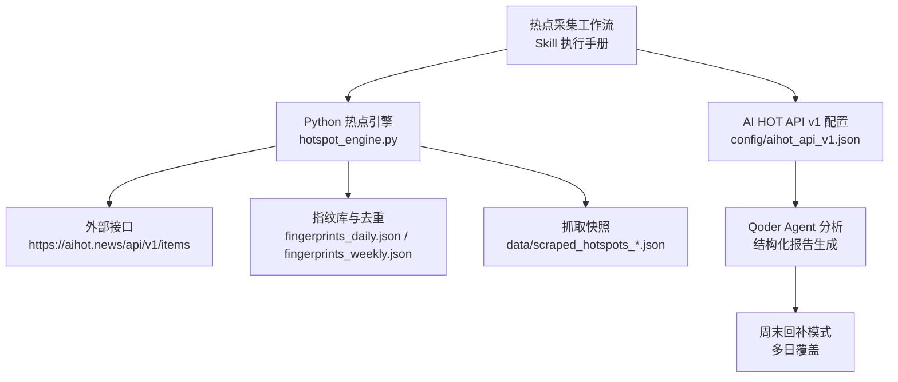
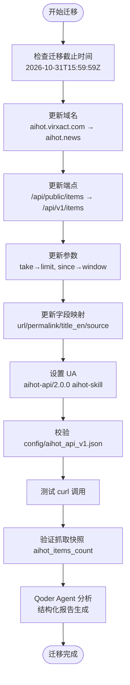
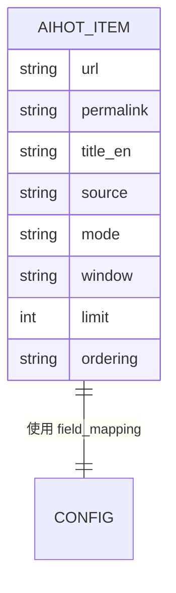
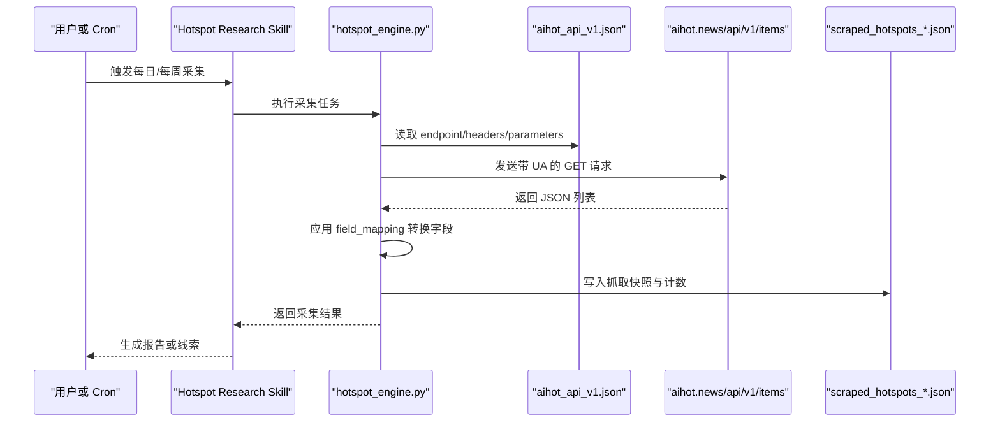
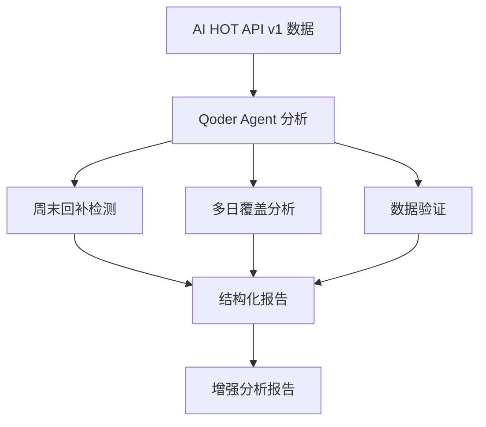
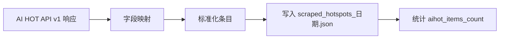

# AI HOT API v1 迁移配置

<cite>
**本文引用的文件**   
- [config/aihot_api_v1.json](file://config/aihot_api_v1.json)
- [skills/hotspot-research/SKILL.md](file://skills/hotspot-research/SKILL.md)
- [skills/hotspot-research_qoder_v2/SKILL.md](file://skills/hotspot-research_qoder_v2/SKILL.md)
- [scripts/hotspot_engine.py](file://scripts/hotspot_engine.py)
- [data/scraped_hotspots_2026-09-09.json](file://data/scraped_hotspots_2026-09-09.json)
- [data/scraped_hotspots_2026-09-10.json](file://data/scraped_hotspots_2026-09-10.json)
- [data/scraped_hotspots_2026-09-12.json](file://data/scraped_hotspots_2026-09-12.json)
- [data/scraped_hotspots_2026-09-13.json](file://data/scraped_hotspots_2026-09-13.json)
- [data/scraped_hotspots_2026-09-14.json](file://data/scraped_hotspots_2026-09-14.json)
- [data/scraped_hotspots_2026-09-15.json](file://data/scraped_hotspots_2026-09-15.json)
- [data/scraped_hotspots_2026-09-17.json](file://data/scraped_hotspots_2026-09-17.json)
- [data/scraped_hotspots_2026-09-20.json](file://data/scraped_hotspots_2026-09-20.json)
- [data/scraped_hotspots_2026-09-21.json](file://data/scraped_hotspots_2026-09-21.json)
- [data/scraped_hotspots_2026-09-22.json](file://data/scraped_hotspots_2026-09-22.json)
- [data/aihot_1004_top15.json](file://data/aihot_1004_top15.json)
- [data/aihot_1005_top5.json](file://data/aihot_1005_top5.json)
</cite>

## 更新摘要
**变更内容**   
- 更新了API端点和域名迁移的详细说明
- 新增了Qoder Agent分析流程和数据验证机制
- 扩展了周末回补模式和多日覆盖功能说明
- 增强了数据结构映射和字段验证规则
- 完善了故障排查和降级策略

## 目录
1. [引言](#引言)
2. [项目结构与定位](#项目结构与定位)
3. [AI HOT API v1 迁移总览](#ai-hot-api-v1-迁移总览)
4. [核心配置文件解析](#核心配置文件解析)
5. [字段映射与数据模型](#字段映射与数据模型)
6. [采集流程与调用时序](#采集流程与调用时序)
7. [Qoder Agent分析与增强功能](#qoder-agent分析与增强功能)
8. [兼容性与降级策略](#兼容性与降级策略)
9. [历史数据与指标约定](#历史数据与指标约定)
10. [性能与可靠性建议](#性能与可靠性建议)
11. [故障排查清单](#故障排查清单)
12. [结论与迁移检查表](#结论与迁移检查表)

## 引言
本文件聚焦"AI HOT API v1 迁移配置"，说明如何将热点采集系统从旧版 `aihot.virxact.com/api/public/*` 成功迁移到新版 `https://aihot.news/api/v1/items`，并给出配置结构、字段映射、调用参数、兼容性约束和排错路径。文档同时覆盖 Python 引擎、Skill 执行手册以及已产出的抓取快照数据，帮助读者在不直接阅读源码的情况下完成迁移验证。

**重要更新**：系统现已完成从 deprecated AI HOT API 到新 v1 端点的迁移，通过 Qoder Agent 分析处理 AI HOT API v1 数据，生成结构化报告，具备周末回补模式、多日覆盖和改进的数据验证能力。

## 项目结构与定位
在本仓库中，AI HOT API v1 的迁移配置主要位于以下位置：
- 配置中心：`config/aihot_api_v1.json`
- 执行策略与迁移说明：`skills/hotspot-research/SKILL.md`、`skills/hotspot-research_qoder_v2/SKILL.md`
- 批量采集引擎：`scripts/hotspot_engine.py`
- 历史抓取产物：`data/scraped_hotspots_*.json`
- AI HOT 数据样本：`data/aihot_*.json`

**图示来源**
- [skills/hotspot-research/SKILL.md:19-32](file://skills/hotspot-research/SKILL.md#L19-L32)
- [config/aihot_api_v1.json:1-22](file://config/aihot_api_v1.json#L1-L22)
- [scripts/hotspot_engine.py:1-22](file://scripts/hotspot_engine.py#L1-L22)

**章节来源**
- [README.md:1-29](file://README.md#L1-L29)
- [skills/hotspot-research/SKILL.md:19-32](file://skills/hotspot-research/SKILL.md#L19-L32)

## AI HOT API v1 迁移总览
根据 Skill 文档中的迁移说明，本次迁移的核心变化包括：
- 域名变更：`https://aihot.virxact.com` → `https://aihot.news`
- 端点变更：`/api/public/items` → `/api/v1/items`
- 参数变更：`take=50` → `limit=20`；`since=$timestamp` → `window=24h`
- 字段变更：`url` → `links.original`；`permalink` → `links.aihot`；`title_en` → `originalTitle`；`source` → `source.name`
- 强制 UA：请求头需携带 `aihot-api/2.0.0 aihot-skill`
- 迁移截止时间：`2026-10-31T15:59:59Z`

这些规则在配置文件中被结构化表达，并在 Skill 文档中以命令和说明形式重复强调。

**图示来源**
- [skills/hotspot-research/SKILL.md:19-32](file://skills/hotspot-research/SKILL.md#L19-L32)
- [config/aihot_api_v1.json:1-22](file://config/aihot_api_v1.json#L1-L22)

**章节来源**
- [skills/hotspot-research/SKILL.md:19-32](file://skills/hotspot-research/SKILL.md#L19-L32)
- [config/aihot_api_v1.json:1-22](file://config/aihot_api_v1.json#L1-L22)

## 核心配置文件解析
`config/aihot_api_v1.json` 是本次迁移的核心配置，包含版本、端点、请求头、压缩与 ETag 支持、迁移截止时间、字段映射和默认查询参数。

| 配置项 | 含义 | 当前值或行为 |
|---|---|---|
| `api_version` | API 版本标识 | `v1` |
| `endpoint` | 新接口地址 | `https://aihot.news/api/v1/items` |
| `headers.User-Agent` | 客户端标识 | `aihot-api/2.0.0 aihot-skill` |
| `compression` | 是否启用压缩 | `true` |
| `etag_support` | 是否启用 ETag 缓存 | `true` |
| `migration_deadline` | 迁移截止时间 | `2026-10-31T15:59:59Z` |
| `field_mapping` | 新旧字段映射 | 见下一节 |
| `parameters` | 默认查询参数 | `mode=selected`, `window=24h`, `limit=20`, `ordering=timelineDesc` |

该配置明确了 v1 接口的访问契约，也作为后续脚本、Skill 和报告生成阶段的统一来源。

**章节来源**
- [config/aihot_api_v1.json:1-22](file://config/aihot_api_v1.json#L1-L22)

## 字段映射与数据模型
AI HOT API v1 返回的数据结构相比旧版发生变化，配置文件中通过 `field_mapping` 明确映射关系：

| 输出字段 | 新接口字段路径 | 说明 |
|---|---|---|
| `url` | `links.original` | 原始链接 |
| `permalink` | `links.aihot` | AI HOT 专属永久链接 |
| `title_en` | `originalTitle` | 英文标题 |
| `source` | `source.name` | 来源名称 |

建议在数据处理层使用上述映射，将 API 响应转换为内部统一结构，避免下游模板、报告和统计逻辑因字段名变化而失效。

**图示来源**
- [config/aihot_api_v1.json:10-15](file://config/aihot_api_v1.json#L10-L15)

**章节来源**
- [config/aihot_api_v1.json:10-15](file://config/aihot_api_v1.json#L10-L15)

## 采集流程与调用时序
结合 Skill 文档与 Python 引擎的职责，AI HOT API v1 的典型调用时序如下：

**图示来源**
- [skills/hotspot-research/SKILL.md:19-32](file://skills/hotspot-research/SKILL.md#L19-L32)
- [config/aihot_api_v1.json:1-22](file://config/aihot_api_v1.json#L1-L22)
- [scripts/hotspot_engine.py:1-22](file://scripts/hotspot_engine.py#L1-L22)

**章节来源**
- [skills/hotspot-research/SKILL.md:19-32](file://skills/hotspot-research/SKILL.md#L19-L32)
- [scripts/hotspot_engine.py:1-22](file://scripts/hotspot_engine.py#L1-L22)

## Qoder Agent分析与增强功能
**新增功能**：系统现已集成 Qoder Agent 进行深度分析，提供以下增强能力：

### 周末回补模式
- 自动识别周末缺失的数据点
- 支持周五至周日的信息回溯采集
- 周一报告自动标注 `[周末回补 M/D]`

### 多日覆盖
- 支持跨日期热点追踪
- 持续发酵事件标记 `[持续追踪 D+N]`
- 长周期分析发布的时间戳管理

### 改进的数据验证
- 实时数据完整性检查
- 字段映射验证
- 时间窗口有效性验证
- 数据质量评分机制

**章节来源**
- [skills/hotspot-research_qoder_v2/SKILL.md:1-269](file://skills/hotspot-research_qoder_v2/SKILL.md#L1-L269)

## 兼容性与降级策略
### 兼容边界
- 旧版接口 `aihot.virxact.com/api/public/*` 将在 `2026-10-31T15:59:59Z` 后彻底停用。
- 新接口要求正确的 UA、压缩与 ETag 支持，且参数语义发生变化。
- 字段路径变化要求数据处理层做映射，不能假设旧字段仍可用。

### 降级路径
当 AI HOT API v1 不可用时，Skill 文档建议采用替代路径：
- Brave News 中文关键词搜索
- 搜狗微信搜索
- 手动补采（交互式 session）

此外，Skill 中还提到认证墙问题：若返回 HTML 而非 JSON，应跳过 AI HOT 采集并使用替代源，同时在报告中标注不可用原因。

**章节来源**
- [skills/hotspot-research/SKILL.md:19-32](file://skills/hotspot-research/SKILL.md#L19-L32)
- [skills/hotspot-research/SKILL.md:51-64](file://skills/hotspot-research/SKILL.md#L51-L64)

## 历史数据与指标约定
从 `data/scraped_hotspots_*.json` 的历史快照可以看出，系统对 AI HOT 数据有明确的计数字段 `aihot_items_count`，用于统计每次抓取到的条目数量。例如：
- `2026-09-10`：13 条
- `2026-09-12`：7 条
- `2026-09-13`：5 条
- `2026-09-14`：2 条
- `2026-09-15`：10 条
- `2026-09-17`：7 条
- `2026-09-20`：4 条
- `2026-09-21`：7 条
- `2026-09-22`：10 条

这些数字可用于迁移后的回归验证：如果 v1 返回量显著异常下降，需要检查参数、UA、分页限制和字段映射是否正确。

**图示来源**
- [config/aihot_api_v1.json:10-15](file://config/aihot_api_v1.json#L10-L15)
- [data/scraped_hotspots_2026-09-10.json:3-4](file://data/scraped_hotspots_2026-09-10.json#L3-L4)

**章节来源**
- [data/scraped_hotspots_2026-09-10.json:3-4](file://data/scraped_hotspots_2026-09-10.json#L3-L4)
- [data/scraped_hotspots_2026-09-12.json:3-4](file://data/scraped_hotspots_2026-09-12.json#L3-L4)
- [data/scraped_hotspots_2026-09-13.json:3-4](file://data/scraped_hotspots_2026-09-13.json#L3-L4)
- [data/scraped_hotspots_2026-09-14.json:3-4](file://data/scraped_hotspots_2026-09-14.json#L3-L4)
- [data/scraped_hotspots_2026-09-15.json:3-4](file://data/scraped_hotspots_2026-09-15.json#L3-L4)
- [data/scraped_hotspots_2026-09-17.json:3-4](file://data/scraped_hotspots_2026-09-17.json#L3-L4)
- [data/scraped_hotspots_2026-09-20.json:3-4](file://data/scraped_hotspots_2026-09-20.json#L3-L4)
- [data/scraped_hotspots_2026-09-21.json:3-4](file://data/scraped_hotspots_2026-09-21.json#L3-L4)
- [data/scraped_hotspots_2026-09-22.json:3-4](file://data/scraped_hotspots_2026-09-22.json#L3-L4)

## 性能与可靠性建议
基于配置文件和 Skill 文档，可得出以下优化方向：
- 启用压缩与 ETag：减少带宽并提升重复请求效率。
- 控制 `limit`：默认 `limit=20`，避免单次请求过大导致超时或下游处理压力。
- 固定 UA：确保不被网关拦截，提高成功率。
- 参数稳定：使用 `mode=selected`、`window=24h`、`ordering=timelineDesc`，保证日报/周报的时间窗口一致。
- 失败重试与降级：网络异常时优先重试一次，再切换到 Brave News 与搜狗微信等替代源。
- Qoder Agent 分析：利用智能分析提升数据质量和报告深度。

**章节来源**
- [config/aihot_api_v1.json:4-21](file://config/aihot_api_v1.json#L4-L21)
- [skills/hotspot-research/SKILL.md:19-32](file://skills/hotspot-research/SKILL.md#L19-L32)

## 故障排查清单
| 现象 | 可能原因 | 排查步骤 | 处理建议 |
|---|---|---|---|
| 返回 HTML 登录页 | 认证墙或 UA 不正确 | 检查 UA 是否为 `aihot-api/2.0.0 aihot-skill` | 修正 UA；如仍失败则走降级路径 |
| 返回空列表 | 时间窗口无精选内容 | 检查 `window`、`mode`、`limit` | 扩大时间窗口或切换为 WebSearch 补充 |
| 字段缺失 | 字段映射未更新 | 检查 `field_mapping` | 按配置映射 `links.original`、`links.aihot`、`originalTitle`、`source.name` |
| 抓取数量异常下降 | 参数或限流变化 | 对比历史 `aihot_items_count` | 调整 `limit`、检查服务端限流或改用替代源 |
| 迁移截止后无法访问 | 旧接口已下线 | 确认是否仍指向 `aihot.virxact.com` | 全部切到 `aihot.news/api/v1/items` |
| Qoder Agent 分析失败 | 分析引擎异常 | 检查 Agent 连接状态 | 回退到基础数据采集模式 |
| 周末回补数据缺失 | 回补模式未启用 | 检查周末回补配置 | 启用周末回补模式并重新运行 |

**章节来源**
- [skills/hotspot-research/SKILL.md:51-64](file://skills/hotspot-research/SKILL.md#L51-L64)
- [config/aihot_api_v1.json:1-22](file://config/aihot_api_v1.json#L1-L22)

## 结论与迁移检查表
### 迁移检查表
- [ ] 已将域名改为 `https://aihot.news`
- [ ] 已将端点改为 `/api/v1/items`
- [ ] 已将 `take` 改为 `limit=20`
- [ ] 已将 `since` 改为 `window=24h`
- [ ] 已设置 UA 为 `aihot-api/2.0.0 aihot-skill`
- [ ] 已启用压缩与 ETag
- [ ] 已实现字段映射：`url`、`permalink`、`title_en`、`source`
- [ ] 已验证 `aihot_items_count` 与历史趋势基本一致
- [ ] 已准备降级路径：Brave News + 搜狗微信
- [ ] 已在迁移截止前完成切换
- [ ] 已启用 Qoder Agent 分析功能
- [ ] 已配置周末回补模式
- [ ] 已验证多日覆盖功能

### 最终建议
- 以 `config/aihot_api_v1.json` 作为唯一权威配置，避免多处硬编码 URL 和字段名。
- 在 Skill 与脚本中统一引用该配置，降低未来再次升级时的维护成本。
- 保留历史快照与统计字段，便于迁移后做回归对比。
- 对 AI HOT 可用性增加预检逻辑，失败时自动降级并记录告警。
- 充分利用 Qoder Agent 的分析能力，提升数据质量和报告深度。
- 定期监控周末回补和多日覆盖功能的运行状态。

**章节来源**
- [config/aihot_api_v1.json:1-22](file://config/aihot_api_v1.json#L1-L22)
- [skills/hotspot-research/SKILL.md:19-32](file://skills/hotspot-research/SKILL.md#L19-L32)