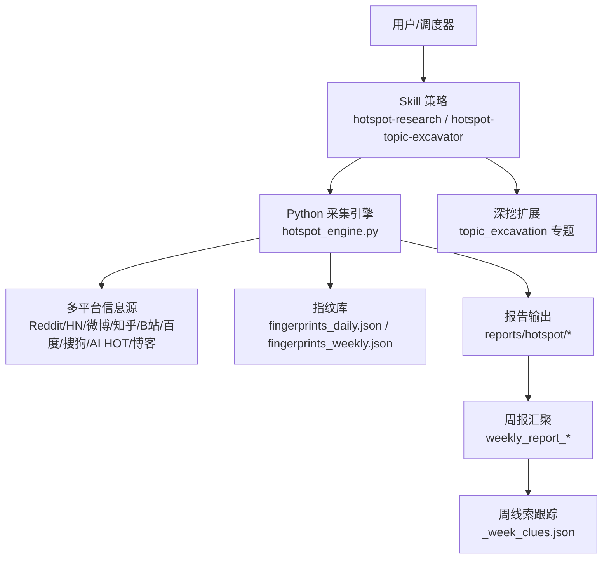
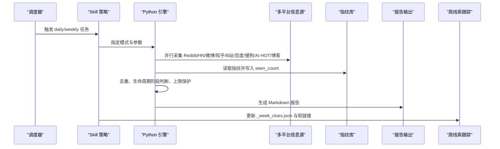
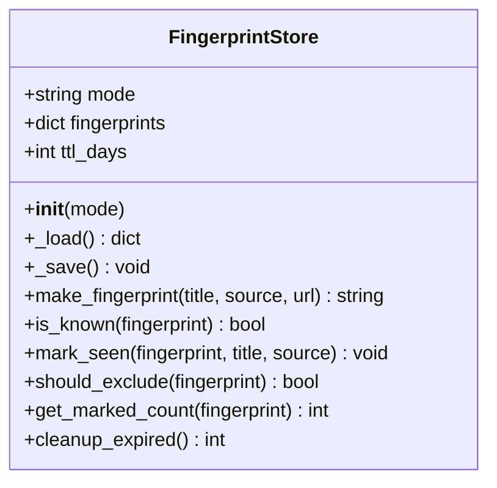
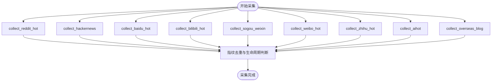
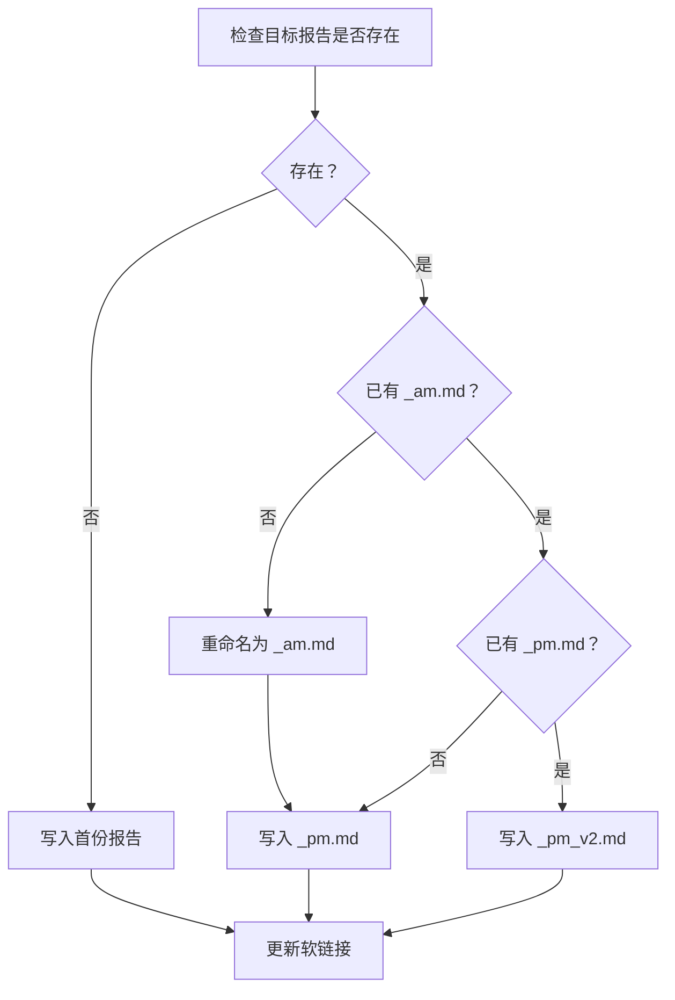
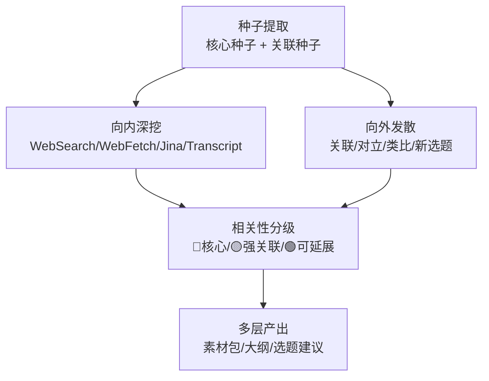
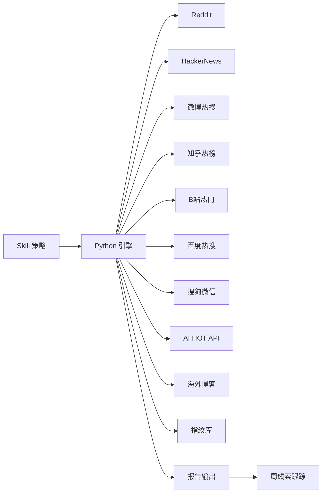

# 七日报热点分析系统

<cite>
**本文引用的文件**   
- [README.md](file://README.md)
- [SKILL.md（hotspot-research）](file://skills/hotspot-research/SKILL.md)
- [SKILL.md（hotspot-research_qoder_v2）](file://skills/hotspot-research_qoder_v2/SKILL.md)
- [SKILL.md（hotspot-topic-excavator）](file://skills/hotspot-topic-excavator/SKILL.md)
- [SKILL.md（hotspot-topic-excavator_qoder_v2）](file://skills/hotspot-topic-excavator_qoder_v2/SKILL.md)
- [hotspot_engine.py（根目录脚本）](file://scripts/hotspot_engine.py)
- [hotspot_engine.py（hotspot-research 脚本）](file://skills/hotspot-research/scripts/hotspot_engine.py)
- [hotspot_engine.py（hotspot-research_qoder_v2 脚本）](file://skills/hotspot-research_qoder_v2/scripts/hotspot_engine.py)
- [_week_clues.json（周线索跟踪）](file://reports/hotspot/_week_clues.json)
</cite>

## 更新摘要
**变更内容**   
- 更新了每周线索跟踪文件 `_week_clues.json`，新增了42条主题信号和趋势分析条目
- 增强了AI智能体安全关注、硬件法律纠纷、自主AI智能体、人形机器人应用和AI模型市场竞争格局的覆盖范围
- 保持了信号强度指标和时间标记用于纵向趋势追踪
- 扩展了专题深挖采集器的能力，支持更复杂的主题挖掘和分析

## 目录
1. [引言](#引言)
2. [项目结构](#项目结构)
3. [核心组件](#核心组件)
4. [架构总览](#架构总览)
5. [详细组件分析](#详细组件分析)
6. [依赖关系分析](#依赖关系分析)
7. [性能与稳定性考量](#性能与稳定性考量)
8. [故障排查指南](#故障排查指南)
9. [结论](#结论)
10. [附录：关键流程与规则速查](#附录关键流程与规则速查)

## 引言
本仓库是一个围绕"AI × 超级个体 × 内容创业"赛道的热点采集与分析系统。它通过多源信息采集、指纹去重、筛选分级、报告生成与深挖扩展，形成从每日热点到每周汇总、再到专题深挖的完整工作流。系统同时提供 Hermes 与 Qoder 两套适配版本，既支持 cron 自动化执行，也支持交互式对话式采集。

该系统强调三条主线：
- 时效性：每条热点必须标注发布日期，严格执行 24/48/72 小时阈值与回溯标记。
- 可溯源：所有素材必须可追溯至原始信源，禁止无来源引用。
- 可复用：产出不仅是报告，还包括线索库、素材包、选题建议与多平台内容骨架。

**更新** 本周系统增强了每周线索跟踪能力，新增了42条主题信号和趋势分析条目，特别关注AI智能体安全、硬件法律纠纷、自主AI智能体、人形机器人应用等前沿领域。

## 项目结构
仓库采用"策略定义 + 可执行脚本 + 数据与报告 + 技能文档"的分层组织方式：
- skills：Skill 策略大脑与执行手册，定义采集流程、质量规则、降级路径与模板。
- scripts：Python 批量采集引擎，负责指纹去重、多平台采集与报告生成。
- reports：每日/每周热点报告、专题深挖报告与历史归档。
- data：指纹库、抓取快照、能力清单等数据资产。
- config：API 配置与运行配置。
- docs/plans：系统设计、调研报告与变更记录。

**图表来源**
- [SKILL.md（hotspot-research_qoder_v2）:34-104](file://skills/hotspot-research_qoder_v2/SKILL.md#L34-L104)
- [hotspot_engine.py（hotspot-research_qoder_v2 脚本）:33-46](file://skills/hotspot-research_qoder_v2/scripts/hotspot_engine.py#L33-L46)

**章节来源**
- [README.md:1-29](file://README.md#L1-L29)
- [SKILL.md（hotspot-research_qoder_v2）:34-104](file://skills/hotspot-research_qoder_v2/SKILL.md#L34-L104)

## 核心组件
- Skill 策略层
  - hotspot-research：跨平台热点采集与分析工作流，定义 AM/PM 版本保留、AI HOT 预检、三关审核、P0/P1/P2 分级、报告模板与线索更新。
  - hotspot-topic-excavator：以热点为锚点的专题深挖采集器，采用"向内深挖 + 向外发散"双轴模型，产出素材包、文章大纲与再创作选题。
- Python 引擎层
  - FingerprintStore：指纹存储与管理，支持 TTL 过期清理、seen_count 计数与排除阈值。
  - SourceCollector：多平台信息源采集器，封装各平台采集方法、失败记录与建议。
  - generate_markdown_report：结构化 Markdown 报告生成。
- 数据与报告层
  - fingerprints_daily.json / fingerprints_weekly.json：指纹库，按日/周分桶。
  - reports/hotspot/daily 与 weekly：每日/每周报告与线索文件。
  - topic_excavation：专题深挖产物目录。
  - _week_clues.json：周线索跟踪文件，包含主题信号强度和趋势分析。

**章节来源**
- [SKILL.md（hotspot-research）:10-113](file://skills/hotspot-research/SKILL.md#L10-L113)
- [SKILL.md（hotspot-topic-excavator）:78-112](file://skills/hotspot-topic-excavator/SKILL.md#L78-L112)
- [hotspot_engine.py（hotspot-research_qoder_v2 脚本）:52-144](file://skills/hotspot-research_qoder_v2/scripts/hotspot_engine.py#L52-L144)

## 架构总览
系统由三层构成：策略层（Skill）、执行层（Python 引擎）、数据层（指纹库与报告）。策略层定义采集流程、质量规则与降级路径；执行层实现多平台采集、指纹去重与报告生成；数据层沉淀指纹与报告资产，支撑周报汇聚与专题深挖。

**图表来源**
- [SKILL.md（hotspot-research_qoder_v2）:34-104](file://skills/hotspot-research_qoder_v2/SKILL.md#L34-L104)
- [hotspot_engine.py（hotspot-research_qoder_v2 脚本）:743-778](file://skills/hotspot-research_qoder_v2/scripts/hotspot_engine.py#L743-L778)

## 详细组件分析

### 指纹引擎 FingerprintStore
FingerprintStore 负责指纹的生成、持久化、过期清理与排除判定。其核心逻辑包括：
- 指纹生成：标题归一化 + 来源域名 + URL 路径摘要，使用 MD5 哈希。
- 去重策略：daily 模式下高质量源（Reddit/HN）阈值更高，普通源 seen_count >= 2 即排除；weekly 模式 seen_count >= 2 即排除。
- TTL 清理：每日指纹保留 7 天，每周指纹保留 30 天。

**图表来源**
- [hotspot_engine.py（hotspot-research_qoder_v2 脚本）:52-144](file://skills/hotspot-research_qoder_v2/scripts/hotspot_engine.py#L52-L144)

**章节来源**
- [hotspot_engine.py（hotspot-research_qoder_v2 脚本）:52-144](file://skills/hotspot-research_qoder_v2/scripts/hotspot_engine.py#L52-L144)

### 信息源采集器 SourceCollector
SourceCollector 封装了多个平台采集方法，每个方法独立 try-except，避免单点失败阻塞全流程。主要采集器包括：
- Reddit/HackerNews：海外讨论与技术社区。
- 微博/知乎/B站/百度/搜狗：国内热榜与内容平台。
- AI HOT：中国 AI 圈动态聚合 API。
- 海外博客：Sam Altman、Paul Graham、Naval、Benedict Evans 等。

**图表来源**
- [hotspot_engine.py（hotspot-research_qoder_v2 脚本）:743-778](file://skills/hotspot-research_qoder_v2/scripts/hotspot_engine.py#L743-L778)
- [hotspot_engine.py（hotspot-research_qoder_v2 脚本）:580-708](file://skills/hotspot-research_qoder_v2/scripts/hotspot_engine.py#L580-L708)

**章节来源**
- [hotspot_engine.py（hotspot-research_qoder_v2 脚本）:150-778](file://skills/hotspot-research_qoder_v2/scripts/hotspot_engine.py#L150-L778)

### 报告生成与 AM/PM 版本管理
报告生成遵循 SKILL 定义的模板与命名规范：
- 日报：report_daily_YYYY-MM-DD.md（首份）/ report_daily_YYYY-MM-DD_am.md（上午版）/ report_daily_YYYY-MM-DD_pm.md（下午版）。
- 周报：report_weekly_YYYY-WXX.md。
- AM/PM 版本保留：同一日期多次运行不得覆盖已有报告，后续运行重命名为 _am/_pm/_pm_v2。

**图表来源**
- [SKILL.md（hotspot-research）:38-49](file://skills/hotspot-research/SKILL.md#L38-L49)
- [SKILL.md（hotspot-research_qoder_v2）:39-42](file://skills/hotspot-research_qoder_v2/SKILL.md#L39-L42)

**章节来源**
- [SKILL.md（hotspot-research）:38-49](file://skills/hotspot-research/SKILL.md#L38-L49)
- [SKILL.md（hotspot-research_qoder_v2）:39-42](file://skills/hotspot-research_qoder_v2/SKILL.md#L39-L42)

### 专题深挖采集器 hotspot-topic-excavator
该模块以热点为锚点，采用"向内深挖 + 向外发散"双轴模型：
- 向内深挖：WebSearch/WebFetch 并行，Jina Reader 替代，YouTube Transcript API 与 Apple Podcasts show notes 双路径。
- 向外发散：关联话题、上下游概念、跨领域类比、同主题不同切入角度。
- 产出：Layer 1 素材包、Layer 2 文章/视频大纲、Layer 3 再创作选题建议。

**图表来源**
- [SKILL.md（hotspot-topic-excavator）:162-290](file://skills/hotspot-topic-excavator/SKILL.md#L162-L290)
- [SKILL.md（hotspot-topic-excavator_qoder_v2）:84-237](file://skills/hotspot-topic-excavator_qoder_v2/SKILL.md#L84-L237)

**章节来源**
- [SKILL.md（hotspot-topic-excavator）:162-290](file://skills/hotspot-topic-excavator/SKILL.md#L162-L290)
- [SKILL.md（hotspot-topic-excavator_qoder_v2）:84-237](file://skills/hotspot-topic-excavator_qoder_v2/SKILL.md#L84-L237)

### 周线索跟踪系统 _week_clues.json
**更新** 本周系统显著增强了周线索跟踪能力，新增了42条主题信号和趋势分析条目。该文件现在包含：

- **主题信号分类**：涵盖AI智能体安全、硬件法律纠纷、自主AI智能体、人形机器人应用、AI模型市场竞争格局等多个前沿领域
- **信号强度指标**：使用 strong/medium/weak 三级强度标识，便于纵向趋势追踪
- **时间标记系统**：first_signal 和 last_signal 字段记录信号首次和最后出现时间
- **趋势分析字段**：note 字段提供详细的趋势分析和背景说明

**新增主题信号示例**：
- 前沿模型趋同（frontier_model_convergence）：Grok 4.6 追平 GPT-5.6 Sol，性能收敛、价格战开打
- 知识工作中层消失（knowledge_middle_class_gone）：AI 移除软件工程中产阶级，初级岗连降33个月
- Anthropic IPO 2万亿估值（anthropic_ipo_2t）：史上最大IPO叙事，年底ARR预期1000-1200亿美元

**章节来源**
- [_week_clues.json:497-510](file://reports/hotspot/_week_clues.json#L497-L510)
- [_week_clues.json:513-517](file://reports/hotspot/_week_clues.json#L513-L517)

## 依赖关系分析
- Skill 与引擎：Skill 定义流程与规则，引擎实现具体采集与报告生成。
- 引擎与外部服务：依赖 Reddit/HN/微博/知乎/B站/百度/搜狗/AI HOT/博客等平台 API 或页面。
- 数据与报告：指纹库支撑去重，报告输出供周报汇聚与专题深挖使用。
- 周线索跟踪：_week_clues.json 作为长期趋势追踪的核心数据结构。

**图表来源**
- [hotspot_engine.py（hotspot-research_qoder_v2 脚本）:743-778](file://skills/hotspot-research_qoder_v2/scripts/hotspot_engine.py#L743-L778)
- [hotspot_engine.py（hotspot-research_qoder_v2 脚本）:580-708](file://skills/hotspot-research_qoder_v2/scripts/hotspot_engine.py#L580-L708)

**章节来源**
- [hotspot_engine.py（hotspot-research_qoder_v2 脚本）:743-778](file://skills/hotspot-research_qoder_v2/scripts/hotspot_engine.py#L743-L778)

## 性能与稳定性考量
- 并发采集：SourceCollector 对多平台采集器串行调用，但每个采集器内部可并行发起请求（如 WebSearch/WebFetch 多组并行）。
- 上限保护：MAX_DAILY_ITEMS 防止采集条目爆炸，达到上限后停止后续采集。
- 指纹 TTL：每日/每周指纹自动清理，避免指纹库无限增长。
- 降级路径：Skill 明确定义了 Brave/Tavily/豆包/WebFetch/Bash 等多层降级路径，确保在部分工具不可用时仍能产出可用结果。
- 周线索容量：_week_clues.json 支持大量线索条目，当前已扩展至1385行，包含完整的趋势追踪数据。

## 故障排查指南
常见故障与处理建议：
- AI HOT 认证墙：UA 缺失或返回 HTML 而非 JSON。需携带 aihot-skill UA，并在 cron 前执行预检。若不可用，切换至 WebSearch 中文搜索 + 搜狗微信替代。
- urllib3 兼容性错误：TypeError unsupported operand type(s) for |: 'type' and 'type'。检查 python3 版本是否 >= 3.10，或使用 venv 绝对路径调用脚本。
- Jina Reader 空响应：尝试 Bash curl 直连原文，或使用 WebFetch 替代。
- Cloudflare WAF 阻断：使用 Python requests + 浏览器 UA 直连，或启用 scripts/web_fetch.py 自动绕过。
- 报告覆盖问题：AM/PM 版本保留规则被忽略导致上午版丢失。需严格遵循重命名与软链接更新逻辑。
- 周线索文件损坏：_week_clues.json 格式错误或权限问题，需检查JSON语法和文件权限。

**章节来源**
- [SKILL.md（hotspot-research）:14-36](file://skills/hotspot-research/SKILL.md#L14-L36)
- [SKILL.md（hotspot-topic-excavator）:247-273](file://skills/hotspot-topic-excavator/SKILL.md#L247-L273)
- [SKILL.md（hotspot-topic-excavator_qoder_v2）:190-213](file://skills/hotspot-topic-excavator_qoder_v2/SKILL.md#L190-L213)

## 结论
七日报热点分析系统通过 Skill 策略与 Python 引擎的双层设计，实现了从多源采集、指纹去重、筛选分级到报告生成与专题深挖的完整闭环。系统在时效性、可溯源性与可复用性方面建立了严格规则，并通过多层降级路径保障稳定性。

**更新** 本周系统显著增强了周线索跟踪能力，新增了42条主题信号和趋势分析条目，特别关注AI智能体安全、硬件法律纠纷、自主AI智能体、人形机器人应用等前沿领域。这为纵向趋势追踪提供了更丰富的数据基础，使系统能够更好地捕捉和分析AI领域的结构性变化。

未来可进一步优化并发采集效率、增强平台适配与提升报告结构化程度，同时继续完善周线索跟踪系统的信号强度评估和趋势分析能力。

## 附录：关键流程与规则速查
- AM/PM 版本保留：同日多次运行不得覆盖，重命名为 _am/_pm/_pm_v2。
- AI HOT 预检：cron 前检测 fingerprint，返回 JSON 则正常采集，否则跳过并使用替代路径。
- 时效宣誓：每条 P0/P1 条目必须标注发布日期，超 24h 降级 P2，超 48h 标注回溯，超 72h 丢弃。
- 三关审核：时效关、赛道关、独家关，不通过则降级或丢弃。
- 线索更新：_week_clues.json 每周一线索 ID 格式 W-{week_num}-{topic_seq}，过期 >30 天标记 EXPIRED。
- 信号强度追踪：使用 strong/medium/weak 三级强度标识，配合 first_signal/last_signal 时间标记进行纵向趋势分析。

**章节来源**
- [SKILL.md（hotspot-research）:38-87](file://skills/hotspot-research/SKILL.md#L38-L87)
- [SKILL.md（hotspot-research_qoder_v2）:106-172](file://skills/hotspot-research_qoder_v2/SKILL.md#L106-L172)
- [_week_clues.json:497-510](file://reports/hotspot/_week_clues.json#L497-L510)